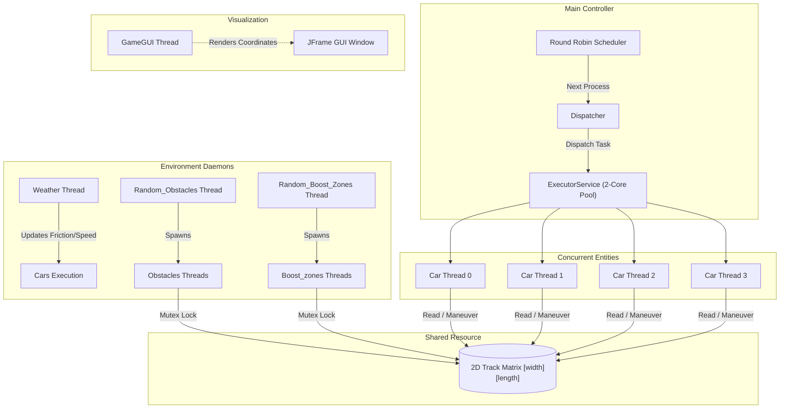
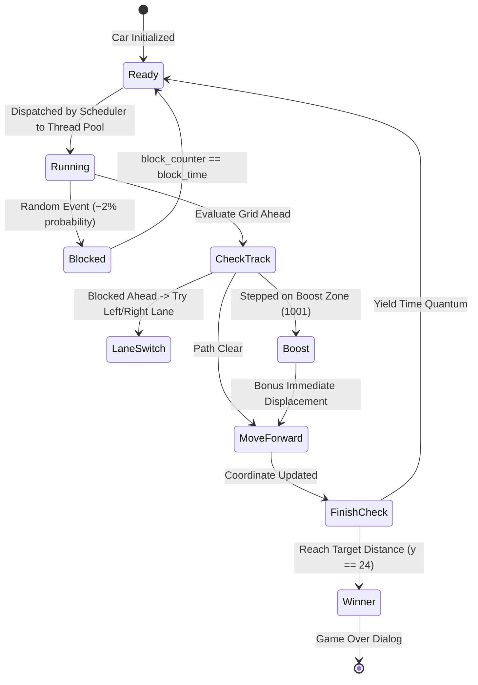

# 🏎️ Multithreaded Car Race Game & OS Scheduling Simulator

[](https://www.java.com/)
[](https://docs.oracle.com/javase/tutorial/uiswing/)
[](https://docs.oracle.com/javase/tutorial/essential/concurrency/)
[](https://en.wikipedia.org/wiki/Scheduling_(computing))

A concurrent 2D racing simulation built in Java that serves as an interactive demonstration of core **Operating System (OS)** principles, including **Round-Robin CPU scheduling**, **dispatcher routines**, **thread pools (multi-core architecture)**, **process state transitions**, and **mutual exclusion synchronization**.

---

## 📌 Table of Contents

- [Overview](#-overview)
- [Operating System Concepts Demonstrated](#-operating-system-concepts-demonstrated)
- [System Architecture](#-system-architecture)
- [Key Features](#-key-features)
- [Simulation Mechanics & State Machine](#-simulation-mechanics--state-machine)
- [Project Structure](#-project-structure)
- [Getting Started & Setup](#-getting-started--setup)
  - [Prerequisites](#prerequisites)
  - [Running with IntelliJ IDEA / Eclipse](#running-with-intellij-idea--eclipse)
  - [Running via Command Line](#running-via-command-line)
- [Configuration & Parameters](#-configuration--parameters)
- [Roadmap & Future Enhancements](#-roadmap--future-enhancements)
- [License](#-license)

---

## 📖 Overview

The **Multithreaded Car Race Game** models an autonomous race between vehicles competing on a multi-lane grid track. Rather than using conventional single-threaded game loops, each entity in this game operates as an independent thread or scheduling task:

- **Cars** represent concurrent processes/threads contending for processor runtime.
- A **Round-Robin Scheduler** and **Dispatcher** allocate CPU burst times to cars using a fixed-size thread pool simulating a dual-core CPU.
- **Dynamic Obstacles** and **Boost Zones** dynamically mutate the shared track grid under mutex locks.
- A background **Weather Daemon** periodically alters track physics and car operational speeds.
- A **Swing GUI** continuously visualizes vehicle coordinates in real-time.

---

## 🧠 Operating System Concepts Demonstrated

| Operating System Concept | Implementation in Simulation |
| :--- | :--- |
| **Processes / Threads** | Each `Car`, `Obstacles`, `Boost_zones`, and `Weather` instance runs as an independent Java `Thread`. |
| **Dual-Core CPU Simulation** | An `ExecutorService` configured with `Executors.newFixedThreadPool(2)` models a 2-core processor handling task bursts. |
| **Round-Robin (RR) Scheduler** | A scheduling loop iterates through the car queue with a defined time quantum (`Thread.sleep(500)`), ensuring fair CPU time distribution. |
| **Dispatcher** | `Main.Dispatcher(...)` acts as the context dispatcher, picking the ready car thread and dispatching it to the execution pool. |
| **Process State Lifecycle** | Cars transition between **Ready** and **Blocked** states (simulating I/O blocks or track stalls). |
| **Mutual Exclusion & Concurrency** | `synchronized` blocks protect shared state mutations on the 2D track grid (`Main.track`), avoiding race conditions. |
| **Daemon / Background Services** | Independent environmental threads continuously manipulate game conditions without stalling active racers. |

---

## 🏗️ System Architecture



---

## ✨ Key Features

### 1. 🔄 Fair Round-Robin Scheduling
The system avoids starvation by sequencing through available racers in a cyclic queue. Each car gets a time slice before yielding control back to the dispatcher.

### 2. ⚡ Multi-Core Thread Pool Execution
Simulates an operating system dispatching runnable threads onto physical CPU cores via Java's `ExecutorService` with a fixed pool size of 2 concurrent worker threads.

### 3. 🌧️ Dynamic Environmental Weather System
An asynchronous background daemon alternates weather states every 3 seconds:
- ☀️ **Sunny (State 0)**: Optimal friction & maximum velocity (`Speed: 2000`).
- 🌧️ **Rainy (State 1)**: Wet conditions, reduced velocity (`Speed: 1000`).
- 🌫️ **Foggy (State 2)**: Hazardous conditions, low velocity (`Speed: 500`).

### 4. 🚧 Dynamic Obstacles & Boost Zones
- **Obstacles (`1000`)**: Randomly spawn on lane tiles. If a car encounters an obstacle, it must either steer to adjacent lanes or sleep for the obstacle duration (`obstacle_time = 5000ms`).
- **Boost Zones (`1001`)**: Provide immediate forward acceleration, triggering bonus displacement maneuvers.

### 5. 🚦 Process State Lifecycle
Vehicles maintain state attributes:
- **`ready`**: Eligible for CPU execution and lane movement.
- **`block`**: Simulates process I/O block; vehicle stays halted for `block_time` clock cycles before returning to the ready queue.

---

## 🕹️ Simulation Mechanics & State Machine



---

## 📁 Project Structure

```text
Car_Race_Game/
├── .idea/                      # IntelliJ project metadata
├── out/                        # Compiled bytecode directory
├── src/                        # Java source files and game assets
│   ├── Main.java               # Entry point, ThreadPool, Round-Robin scheduler & dispatcher
│   ├── Car.java                # Car thread model, movement logic & state transitions
│   ├── GameGUI.java            # Swing graphical user interface and animation loop
│   ├── Weather.java            # Weather background daemon thread
│   ├── Obstacles.java          # Transient obstacle lifecycle thread
│   ├── Random_Obstacles.java   # Generator thread spawning obstacle instances
│   ├── Boost_zones.java        # Transient speed boost lifecycle thread
│   ├── Random_Boost_Zones.java # Generator thread spawning boost zone instances
│   ├── race.jpg                # Track background image
│   ├── car1.png                # Car sprite asset
│   ├── car1-removebg-preview.png # Transparent car sprite asset
│   ├── obstacle.jpg            # Obstacle asset
│   └── obstacle (1).jpg        # Alternative obstacle sprite
├── Operating_system.iml        # IntelliJ module descriptor
└── README.md                   # Comprehensive project documentation
```

---

## 🚀 Getting Started & Setup

### Prerequisites
- **Java Development Kit (JDK 8, 11, 17, or 21+)** installed.
- (Optional) **IntelliJ IDEA**, **Eclipse**, or **VS Code with Java Extension Pack**.

### Running with IntelliJ IDEA / Eclipse
1. Open the project folder in **IntelliJ IDEA** (`File` ➔ `Open` ➔ Select `Car_Race_Game`).
2. Verify the Project SDK is configured (`File` ➔ `Project Structure` ➔ `Project SDK` ➔ JDK 8+).
3. Open `src/Main.java`.
4. Click **Run** (`Shift + F10`) or click the green run arrow next to `public static void main`.

> **Note on Asset Paths**: If images do not appear on your setup, verify the asset paths in [GameGUI.java](file:///src/GameGUI.java) or configure them as relative paths/classpath resources (e.g., using `getClass().getResource(...)`).

### Running via Command Line
Open a terminal (Command Prompt, PowerShell, or Bash) in the project directory:

```bash
# 1. Navigate to the project root
cd "Car_Race_Game"

# 2. Compile all Java files into the bin / out directory
javac -d out src/*.java

# 3. Copy image assets to the compiled output directory
cp src/*.jpg out/ 2>/dev/null || copy src\*.jpg out\
cp src/*.png out/ 2>/dev/null || copy src\*.png out\

# 4. Run the simulation
java -cp out Main
```

---

## ⚙️ Configuration & Parameters

You can tune the simulation in [Main.java](file:///src/Main.java) to experiment with different scheduling behaviors and race dynamics:

| Variable | Default Value | Description |
| :--- | :--- | :--- |
| `number_of_car` | `4` | Total number of participating race threads |
| `length_of_track` | `50` | Length of the track grid matrix |
| `width_of_track` | `number_of_car * 2` | Total lane corridors on track matrix |
| `pool` | `FixedThreadPool(2)` | Number of simultaneous cores executing cars |
| `obstacle_time` | `5000 ms` | Lifetime duration of obstacles |
| `boost_zone_time` | `5000 ms` | Lifetime duration of speed boosts |
| `block_time` | `5 cycles` | Cycles a car remains blocked before recovering |
| `Thread.sleep(500)` | `500 ms` | Time quantum / scheduling delay per dispatcher step |

---

## 🔭 Roadmap & Future Enhancements

- [ ] **Dynamic Preemption & Priority Scheduling**: Implement priority-based scheduling algorithms alongside Round-Robin.
- [ ] **Pathfinding & AI Avoidance**: Implement A* or Dijkstra route planning for cars navigating dense obstacle fields.
- [ ] **Resource-Independent Asset Loading**: Refactor `ImageIcon` file paths to use `ClassLoader.getResource()` for cross-platform portability.
- [ ] **Performance Telemetry**: Add live HUD displays measuring CPU wait times, turnaround times, and scheduling metrics.
- [ ] **Sound Effects**: Audio cues for engine revs, weather changes, and collisions.

---

## 📄 License

This project is created for educational and experimental purposes. Feel free to use, modify, and extend it for Operating Systems and concurrent programming coursework.

---

## Author

Tasneem Ibrahim - Rana Sakr - Marc Ihab - Nadira Mohamed - Fares Abdellatief
